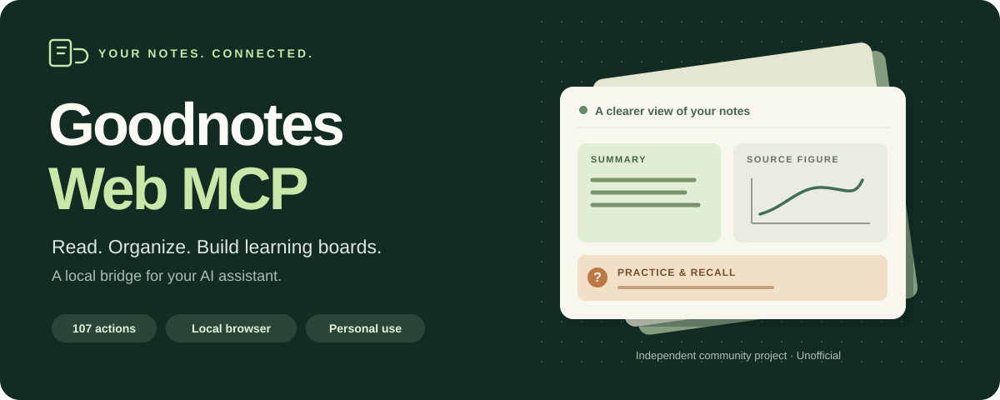
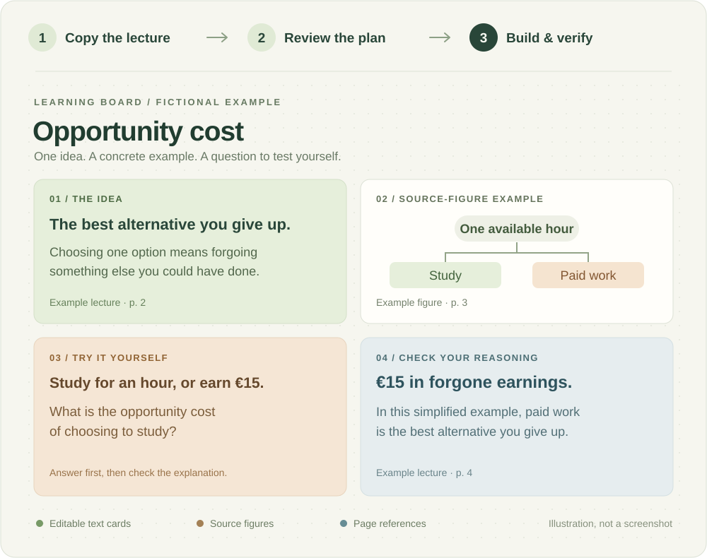

<p align="center">
  
</p>

<p align="center">
  <a href="#quick-start"><strong>Get started</strong></a> ·
  <a href="docs/DE.md">Deutsch</a> ·
  <a href="https://github.com/hb442/goodnotes-web-mcp/releases">Download</a> ·
  <a href="docs/TOOLS.md">Action reference</a> ·
  <a href="https://github.com/hb442/goodnotes-web-mcp/issues">Report an issue</a>
</p>

# Your Goodnotes, with an assistant

Find a passage, organize your notebooks, revise a card, or turn a lecture into a learning board with source images and practice questions. **Goodnotes Web MCP connects a compatible AI assistant to your Goodnotes Web library** through a separate local browser session.

Experimental **v0.21.1**, with 107 actions. Developed and live-tested on Windows with Chrome.

- **Work with your notes:** read, search, organize and build editable learning materials.
- **Keep edits deliberate:** explicit document permissions, saved operation receipts and reload checks.
- **Start with a copy:** try a duplicated board and inspect the result before using originals.

**Unofficial community project.** Not affiliated with Goodnotes. Licensed for **personal, noncommercial use**; [read the terms](LICENSE). The server uses its own browser profile and does not capture or control your desktop.

## From a lecture to a learning board

<p align="center">
  
</p>

*Illustrative layout with fictional material, not a Goodnotes screenshot. Real workflows can use crops from your original lecture slides.*

1. **Copy the source.** Work from a separate lecture copy and read its exported pages.
2. **Plan the material.** Your assistant supplies the summary, questions and page references. The MCP measures the layout and prepares a preview.
3. **Build and check.** Create native text cards and images, save progress, and verify each completed step. Larger lessons can become linked boards with an overview.

[Create a learning board →](docs/STUDY-BOARDS.md) · [Revise selected cards →](docs/STUDY-REVISIONS.md) · [Build a linked collection →](docs/STUDY-COLLECTIONS.md)

## What you can ask your assistant

| Your task | Example request |
| --- | --- |
| **Study a lecture** | “Use a copy of this lecture to make a learning board with original figures, page references, a summary and five practice questions.” |
| **Improve an existing board** | “On a copy of this managed board, shorten the summary card and add two questions. Keep my other notes.” |
| **Find something again** | “Search my indexed notes for opportunity cost and show the matching page excerpts.” |
| **Organize your library** | “List the notebooks in this folder and propose clearer names before changing them.” |
| **Prepare revision material** | “From these pages, prepare a concise study summary and an Anki-compatible TSV file.” |

These are requests for your MCP assistant, not built-in one-click commands. The assistant reads the source and authors the learning content; the server handles the supported Goodnotes operations.

**Also supported:** PDF import/export, local English/German OCR, native handwriting recognition, text formatting, image cropping, page organization, guarded copying/moving, and resumable batches. [See all capabilities](docs/CAPABILITIES.md) or browse the [action reference](docs/TOOLS.md).

## Quick start

You need **Node.js 22.13+**, **Google Chrome or Microsoft Edge**, a Goodnotes account that can access its documents on the Web, and an MCP client that can launch local programs. macOS and Linux have not been tested live.

### 1. Install and sign in

Download and extract the [current source release](https://github.com/hb442/goodnotes-web-mcp/releases/tag/v0.21.1), or clone this repository. Open a terminal in the project folder:

```sh
npm ci --ignore-scripts
npm run browser:install
npm run login
```

Sign in yourself in the separate Chrome window, then **close every window belonging to that separate profile**. The sign-in window runs without automation. Your normal browser profile is not imported. On Windows, `setup.cmd` runs the installation steps for you.

Then check the setup:

```sh
npm run doctor
```

Using Edge? Run `npm run login -- --browser msedge`. [Full setup and troubleshooting](docs/SETUP.md).

### 2. Connect your assistant

Add a local stdio MCP server to your client. Replace the example path with the **absolute path on your computer**:

```json
{
  "mcpServers": {
    "goodnotes-web": {
      "command": "node",
      "args": ["C:/path/to/goodnotes-web-mcp/src/server.mjs"],
      "env": { "GOODNOTES_MCP_MODE": "compact" }
    }
  }
}
```

This example enables **compact mode**: three entry tools discover the same 107 actions as needed. Omit `env` to expose every individual tool. [Compact mode](docs/COMPACT.md) · [Full-mode JSON](examples/mcp-client.json) · [Codex configuration](examples/codex-compact.toml).

A cloud-only MCP client cannot launch this local server directly. Goodnotes and your AI client have their own account and usage requirements; the server does not require a separate paid AI API key.

### 3. Try a copied board

Duplicate a non-critical board in Goodnotes, give the copy a clear title, and authorize that exact URL and title:

```sh
node src/cli.mjs allow "https://web.goodnotes.com/s/YOUR_DOCUMENT_ID" "MCP Test Board"
```

Restart the MCP connection after changing CLI permissions. Existing documents are not writable by default; documents explicitly created or duplicated through the MCP are authorized automatically.

> “Open my authorized test copy, read a text card, and show me its current content. After I choose the edit, update that card and verify the saved result.”

[First edit and recovery guide →](docs/SETUP.md#a-typical-edit)

## What to know before using it

- **It follows the Goodnotes Web UI.** There is no supported Goodnotes editing API behind this project. UI changes can break operations, and most controls currently expect English labels.
- **Verification has a defined scope.** Reload checks confirm the observed Web result. They do not prove delivery to an iPad or prevent simultaneous edits by someone else. Uncertain writes stop for review instead of being replayed.
- **Some features are outside its scope.** Sharing, comments, audio, permanent deletion, lossless `.goodnotes` decoding and full discovery of an infinite board are not exposed. OCR and handwriting recognition are approximate.
- **Local does not mean invisible to your AI client.** Browser credentials, exports and checkpoints are stored locally. Requested tool results go to your MCP client and its model provider. Explicit imports upload the selected file to Goodnotes. [Data and permissions](docs/SETUP.md#local-data) · [Security](SECURITY.md).

The [validation record](docs/VALIDATION.md) separates automated tests, live checks and measured timings. Runtime depends on the document and Goodnotes loading; a complete board has no fixed seven-minute guarantee. [Read all limitations](docs/LIMITATIONS.md).

## Find your way around

| Start here | Go deeper |
| --- | --- |
| [Deutsche Anleitung](docs/DE.md) | [All actions](docs/TOOLS.md) |
| [Setup and first edit](docs/SETUP.md) | [Automation and recovery](docs/AUTOMATION.md) |
| [Learning boards](docs/STUDY-BOARDS.md) | [Revisions](docs/STUDY-REVISIONS.md) · [Collections](docs/STUDY-COLLECTIONS.md) |
| [Releases and downloads](https://github.com/hb442/goodnotes-web-mcp/releases) | [Validation](docs/VALIDATION.md) · [Limitations](docs/LIMITATIONS.md) |
| [Report a reproducible issue](https://github.com/hb442/goodnotes-web-mcp/issues) | [Development guide](docs/DEVELOPMENT.md) |

<details>
<summary><strong>Developing locally</strong></summary>

```sh
npm run check
npm test
npm run test:integration
npm run package:release
```

Browser tests use a synthetic local fixture. Packaging uses an explicit source allowlist and excludes profiles, credentials and private documents. Creating a package does not upload it. Follow the [development and release guide](docs/DEVELOPMENT.md) for live checks and publishing.

</details>

## License

Current distributions use the **[Personal Noncommercial License](LICENSE)**: private use by individuals, including their own studies, with modifications and free sharing under the same terms. Professional, commercial or institutional use requires separate permission. This is source-available software with use restrictions, not an OSI-approved open-source license.

The historical v0.21.0 release was published under MIT; those existing permissions remain unaffected. Third-party components keep their own licenses. [Examples and release history](docs/LICENSING.md).

---

<p align="center"><sub>Goodnotes Web MCP is an independent community project. Goodnotes is a trademark of its respective owner.</sub></p>
