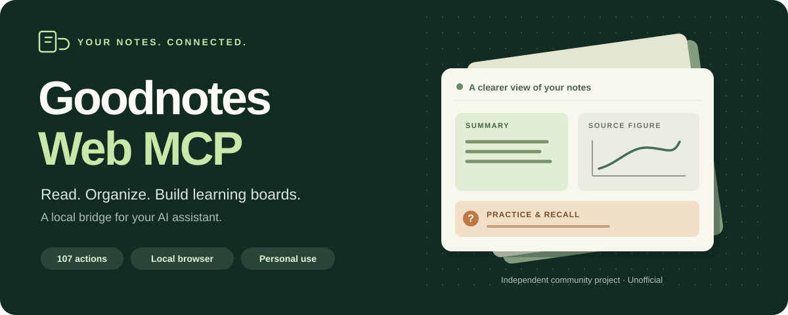
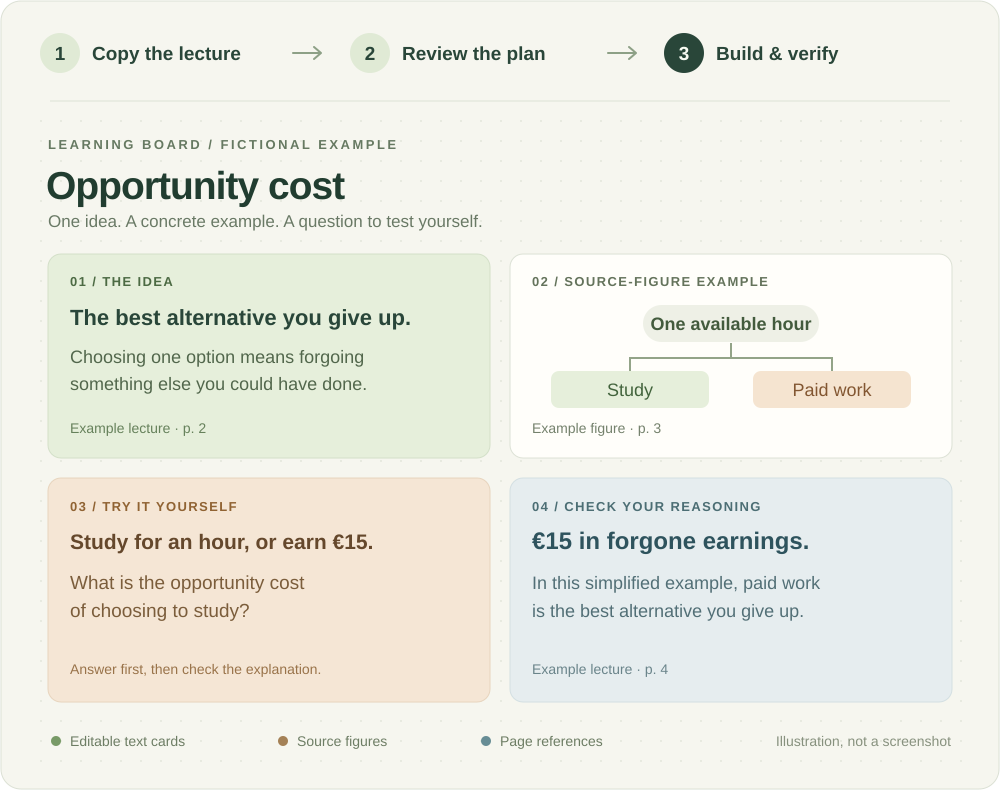

<p align="center">
  
</p>

<p align="center"><a href="../README.md">English</a> · <a href="#einrichten">Einrichten</a> · <a href="https://github.com/hb442/goodnotes-web-mcp/releases">Download</a> · <a href="TOOLS.md">Alle Aktionen</a></p>

# Deine Goodnotes. Mit einem Assistenten.

Eine Stelle wiederfinden, Notizbücher ordnen oder aus einer Vorlesung ein Lernboard erstellen: **Goodnotes Web MCP verbindet einen kompatiblen KI-Assistenten mit deinen Dokumenten in Goodnotes Web.**

Der Helfer läuft in einer eigenen, unsichtbaren Browser-Sitzung. Er steuert weder den Windows-Desktop noch deinen normalen Browser. Ein sichtbares Fenster wird nur für die erste Anmeldung benötigt.

**Experimentelles, unabhängiges Community-Projekt.** Keine offizielle Verbindung zu Goodnotes. Ab Version 0.21.1 gilt die [Lizenz für persönliche, nichtkommerzielle Nutzung](../LICENSE). Das eigene Studium, private Anpassungen und kostenlose Weitergabe unter denselben Bedingungen sind erlaubt. Berufliche, kommerzielle und institutionelle Nutzung benötigen eine gesonderte Erlaubnis. Die frühere MIT-Version und fremde Abhängigkeiten behalten ihre jeweiligen Rechte. [Details und Beispiele](LICENSING.md).

## Von der Vorlesung zum Lernboard

<p align="center">
  
</p>

*Die Grafik zeigt ein erfundenes Lehrbeispiel, keinen Goodnotes-Screenshot. Für deine eigenen Boards können Originalabbildungen aus deinen Folien verwendet werden.*

1. **Quelle kopieren:** Die Vorlesung als separate Kopie vorbereiten und auslesen.
2. **Inhalt und Layout planen:** Der Assistent formuliert Zusammenfassung, Fragen und Seitenbezüge. Der MCP berechnet die Anordnung und erstellt eine Vorschau.
3. **Umsetzen und prüfen:** Bearbeitbare Textkarten und Bilder anlegen, Fortschritt speichern und Änderungen nach Neuladen kontrollieren.

> „Erstelle auf Basis einer Kopie dieser Vorlesung ein übersichtliches Lernboard mit Originalgrafiken, Seitenbezügen und fünf Übungsfragen. Zeige zuerst den Plan.“

[Lernboards erstellen](STUDY-BOARDS.md) · [Einzelne Karten überarbeiten](STUDY-REVISIONS.md) · [Mehrere Boards verknüpfen](STUDY-COLLECTIONS.md)

## Einrichten

1. Node.js ab Version 22.13 installieren.
2. Im Projektordner `setup.cmd` starten. Alternativ: `npm ci --ignore-scripts`, `npm run browser:install`, dann `npm run login`.
3. Im separaten, normalen Chrome-Fenster bei Goodnotes anmelden und danach alle Fenster dieses zusätzlichen Profils schließen. Während der Anmeldung läuft keine automatische Browsersteuerung.
4. Mit `npm run doctor` prüfen, ob die Anmeldung funktioniert.
5. In Goodnotes eine Testkopie erstellen und deren URL sowie exakten Titel freigeben:

```sh
node src/cli.mjs allow "https://web.goodnotes.com/s/DEINE_DOKUMENT_ID" "MCP Test Board"
```

6. Den MCP-Client mit dem absoluten Pfad zu `src/server.mjs` verbinden. Beispiele stehen in `examples/`.

Die Anmeldung bleibt auf deinem Rechner gespeichert. Deine bestehende Browser-Anmeldung wird nicht kopiert. Solange das Anmeldefenster offen ist, kann der Server dieselbe Sitzung nicht verwenden.

Chrome muss installiert sein. Alternativ lässt sich installiertes Edge mit `npm run login -- --browser msedge` verwenden. Der Helfer merkt sich den gewählten Browser. Bei einem Wechsel wird ein eigenes zusätzliches Profil verwendet; vorhandene Profile werden nicht kopiert oder überschrieben.

Google kann die Anmeldung aus automatisch gesteuerten Browsern ablehnen. Deshalb erfolgt die Anmeldung jetzt manuell im normalen Browser. Das ist eine mögliche Ursache für Anmeldefehler, kein Beleg für die Ursache jeder allgemeinen Fehlermeldung.

## Was funktioniert – und was noch offen ist

Version 0.21.1 bietet 107 Aktionen. Der optionale [kompakte Modus](COMPACT.md) stellt nur drei Einstiegswerkzeuge bereit und lädt die genaue Beschreibung einer Aktion bei Bedarf. Die englische [Aktionsreferenz](TOOLS.md) enthält alle Werkzeugnamen und ihre Aufgaben.

<details>
<summary><strong>Alle Funktionen, Abläufe und Grenzen ansehen</strong></summary>

Neben Dokumentverwaltung, Export, Texterkennung und bisherigen Board-Änderungen sind diese Abläufe möglich:

- **Vorlesung zum Lernboard:** `goodnotes_prepare_study_board` legt eine Quellkopie an und exportiert sie. Die aufrufende KI liest die Vorlesung und liefert Zusammenfassung, Übungen, Lösungen und Seitenbezüge. `goodnotes_plan_study_board` schneidet Originalgrafiken aus, prüft Textlängen und Abstände und erstellt eine lokale Vorschau. `goodnotes_run_study_board` setzt den geprüften Plan schrittweise als bearbeitbare Textkarten und Bilder um. Fortschritt und Zeiten bleiben gespeichert; unklare Änderungen werden nicht automatisch wiederholt. Siehe [Ablauf und Grenzen](STUDY-BOARDS.md).

- **Lernboards gezielt aktualisieren:** Einzelne vom MCP verwaltete Karten ersetzen, Bilder oder Karten verschieben und neue Abschnitte ergänzen. Standardmäßig wird auf einer geprüften nativen Kopie gearbeitet. Eigene Ergänzungen außerhalb der gewählten Bereiche bleiben erhalten; veränderte Zielkarten und belegte Zielflächen stoppen den Auftrag. [Ablauf und Grenzen](STUDY-REVISIONS.md).
- **Flexiblere Lernlayouts:** Ein bis drei Spalten, breite Karten/Bilder und thematische Abschnitte. Der neue Sammlungsablauf verteilt bis zu 240 Karten und 120 Originalgrafiken auf höchstens 20 Teilboards, mit Übersicht und nativen Links. Text und Übungen liefert die KI anhand der Quelle; die Aufteilung misst Platz und Abstände automatisch.
- **Ältere Boards übernehmen:** Auf einer geprüften Kopie lassen sich ausgewählte Textfelder und Bilder für spätere gezielte Änderungen erfassen. Originalinhalt und übrige Ergänzungen bleiben erhalten. Das ist keine vollständige Erfassung aller Objekte auf einem unendlichen Board. [Ablauf und Grenzen](STUDY-COLLECTIONS.md).

- Bibliothek mit Unterordnern erfassen und gespeicherte Inhalte durchsuchen.
- Freigegebene Ordner umbenennen und verschieben, auch als verketteten Auftrag; die enthaltenen direkten Einträge werden vor und nach der Änderung verglichen.
- Ordnerfarben, Symbole und Favoriten ändern; Textfelder vollständig farbig hervorheben oder ihre Hervorhebung entfernen.
- Dokumentfavoriten setzen; Textfelder mit Hintergrund, Rahmen, runden Ecken, Innenabstand und Schatten gestalten.
- Bilder, Textfelder, Haftnotizen und Formen gegen Verschieben/Vergrößern sperren und wieder entsperren; dies ist keine Zugriffssperre für andere Personen.
- Beschriftungen innerhalb nativer Formen lesen, ersetzen, formatieren oder leeren, ohne die Form zu löschen, auch als Stapelauftrag; dafür ausdrücklich den Objekttyp `shape` angeben und bei ungefüllten Formen den Rand wählen.
- Die Farbfüllung einzelner nativer Formen in Zehnerschritten sowie ihre Linienstärke ändern; vorhandene Farbe und Geometrie bleiben erhalten.
- Bilder rechteckig zuschneiden. Goodnotes kann dabei die ursprünglichen Bildpixel ersetzen; der Helfer sichert sie deshalb vorab lokal und prüft das gespeicherte Bild.
- Mehrere Änderungen als Plan speichern, schrittweise ausführen und nach einer Unterbrechung fortsetzen.
- PDFs importieren und Seiten hinzufügen, duplizieren, umordnen, drehen, in die Gliederung aufnehmen oder in den Papierkorb verschieben.
- Haftnotizen und Textfelder anhand ihres Textes finden und ihre Anordnung als Auftrag vorbereiten.
- Native Rechtecke, Ellipsen, Dreiecke, Rauten und runde Rechtecke erstellen; Größe und gespeichertes Erscheinungsbild werden geprüft.
- Neue Textfelder, Bilder, Links und gezeichnete Pfeile ergänzen; native Farbvorgaben auf ausgewählte Objekte anwenden.
- Seiten aus Exporten zu einer neuen PDF zusammenstellen sowie Zusammenfassungen, Aufgaben und Karteikarten lokal ausgeben.
- Aufträge verketten: Ein neu angelegter Ordner oder ein neues Board wird automatisch zum Ziel späterer Schritte. Der Fortschritt übersteht Neustarts.
- Größere Board-Bereiche abschnittsweise durchsuchen und gefundene Textobjekte auch nach Verschieben der Ansicht wiederfinden.
- Gliederungseinträge auslesen, umbenennen oder entfernen, mit Prüfung der Einträge und Seitenzuordnung. Auch als verketteter Auftrag; verschachtelte/importierte Gliederungen sind ausgenommen.
- Ganze Seiten sowie einzelne Textfelder, Haftnotizen und Bilder mit den nativen Kopierfunktionen zwischen Dokumenten kopieren.
- Rechteckige Lasso-Auswahlen mit Formen oder Zeichnungen nativ in ein anderes Dokument kopieren; Quelle und gespeichertes Ergebnis werden visuell verglichen. Abweichende Hintergründe oder Überlagerungen können die Prüfung verhindern.
- Einzelne Textfelder, Haftnotizen oder Bilder von einem Board oder einer Notizbuchseite in ein anderes freigegebenes Dokument verschieben. Erst wird gesichert und die Kopie geprüft, dann das unveränderte Original entfernt. Bei einem Fehler können beide Kopien bestehen bleiben; der Vorgang wird nicht blind wiederholt.
- Native Sicherungskopien mit PDF-Vergleich anlegen und in ein neues Dokument wiederherstellen.
- Board-Hintergründe, verfügbare Papier- und Deckblattvorlagen, Seiten-Lesezeichen, Listen, Textfarben, Durchstreichen und Stiftbreiten bearbeiten.
- Haftnotizen ein-/ausklappen, sperren/entsperren, Autor anzeigen/ausblenden und angebotene Ebenenbefehle verwenden.
- Freigegebene Dokumente mit vorherigem PDF-Export in den Papierkorb verschieben und anhand des gesicherten Vorgangs zurückholen.
- Ab Version 0.7 über den MCP gelöschte Seiten sichern und gezielt zurückholen; ursprüngliche Seitenidentitäten, Reihenfolge und PDF-Inhalt werden geprüft. Bereits früher gelöschte Seiten ohne Sicherung sind davon ausgenommen.

Die praktischen Abläufe und genauen Grenzen stehen in [AUTOMATION.md](AUTOMATION.md). Ein Index ist eine gespeicherte Momentaufnahme. Wiederverwendete Auszüge werden nicht bei jeder Suche erneut mit dem iPad verglichen. Für eine sichere Aktualisierung kann ein vollständiger erneuter Export angefordert werden. Bei Stapelaufträgen hält ein unklarer Schreibvorgang die weitere Ausführung an.

Automatische Tests prüfen unter anderem Textkonflikte, Formatierung, native Haftnotizen, PDF-Verarbeitung, Texterkennung, Wiederaufnahme von Aufträgen und das MCP-Protokoll. Zusätzlich wurden ausschließlich eigens angelegte Testdokumente verwendet. Den aktuellen Prüfstand mit Zahlen und tatsächlich getesteten Funktionen enthält [VALIDATION.md](VALIDATION.md). Änderungen wurden nach Neuladen kontrolliert. Diese Live-Prüfungen beziehen sich auf Windows und Chrome; andere Plattformen und sämtliche Goodnotes-Dokumentvarianten sind damit nicht abgedeckt.

Vollständig wie die Goodnotes-App ist der MCP noch nicht: Kommentare/Freigaben, Audio, freihändiger Bildzuschnitt, dauerhafte Objektgruppen, automatisch abgesichertes Verschieben beliebiger Stift-/Bildgruppen zwischen Dokumenten, ältere Papierkorbinhalte und direktes Bearbeiten von PDF-Hintergründen sind nicht implementiert. Große Bibliotheken werden abschnittsweise gelesen; eine Board-Suche gilt nur für den gewählten Bereich. Manche vom Stift geglätteten Pfeilspitzen können die strenge Prüfung verfehlen. Solche Änderungen werden als unbestätigt gemeldet und nicht einfach wiederholt.

Echte Handschrift lässt sich über Goodnotes erkennen und ausdrücklich in bearbeitbaren Text umwandeln. Bei Bildern und gescannten PDFs hilft die lokale Texterkennung; schwierige Handschrift und Formeln müssen am Seitenbild kontrolliert werden. Hintergrundbilder werden nicht in einzelne bearbeitbare Objekte zerlegt. Eine erfolgreiche Prüfung nach Neuladen bestätigt weiterhin nicht die Synchronisierung zum iPad.

Neu über den MCP angelegte Dokumente und Kopien werden automatisch zum Bearbeiten freigegeben. Bestehende Originale benötigen die lokale Freigabe. Für Textänderungen mit vorhandener Formatierung ist `goodnotes_edit_text` vorgesehen; vollständiges Ersetzen mit `goodnotes_write_text` kann gemischte Formatierungen verändern.

Für größere Lernboards zuerst das Endergebnis festlegen: Texte, Positionen, Überschriften und Farben. Der neue Ablauf ab 0.19 erstellt pro Karte Text, Formatierung und Hintergrund gemeinsam und prüft sie anschließend nach dem Neuladen. Bei einzelnen Änderungen an bestehenden Karten können Fließtext und mehrere Überschriftenbereiche über `goodnotes_edit_text.formatRanges` gemeinsam gespeichert werden. Die Bereiche beziehen sich auf den fertigen Text nach dem Ersetzen. Der zurückgegebene `viewId` kann direkt für die nächste Objektauswahl verwendet werden; separate Hintergrundänderungen behalten ihre eigene Prüfung. Das spart wiederholte Zustandsabfragen und Neuladungen, ohne die Speicherprüfung oder den Schutz vor doppelten Schreibvorgängen abzuschalten.

PDFs, Textindizes, Auftragspläne und Belegbilder bleiben im privaten Datenordner. Exportierte Inhalte sind Momentaufnahmen; für aktuelle Inhalte neu exportieren oder `refresh` verwenden. Die lokale Texterkennung lädt keine Seiten zu einem zusätzlichen Dienst hoch. Beim ausdrücklich angeforderten PDF- oder Bildimport wird die gewählte Datei zu Goodnotes hochgeladen. Angeforderte Ergebnisse gehen weiterhin an den verwendeten MCP-Client.

</details>

Der MCP hängt von der Goodnotes-Weboberfläche ab. Nicht jede App-Funktion ist verfügbar, und ein erfolgreicher Web-Test bestätigt keine iPad-Synchronisierung. [Grenzen](LIMITATIONS.md) · [Prüfstand und gemessene Zeiten](VALIDATION.md).

## Beispiel für einen Auftrag an den Assistenten

> Öffne meine freigegebene Testkopie. Zeige einmal die Vorschau und lies das Textfeld, das ich ändern möchte. Ersetze nur dieses Feld durch den vereinbarten Text. Bestätige den Inhalt nach Neuladen. Bei einem unklaren Speicherergebnis nicht automatisch erneut schreiben.

## Zugriff entfernen

```sh
node src/cli.mjs revoke "https://web.goodnotes.com/s/DEINE_DOKUMENT_ID"
```

Danach den MCP-Server neu starten. Zum vollständigen Trennen den Eintrag aus deinem MCP-Client entfernen. Der lokale Goodnotes-Sitzungsordner kann nach Beenden des Helfers separat gelöscht werden; er liegt unter Windows in `%LOCALAPPDATA%/goodnotes-web-mcp`.

## Fehler verständlich erklärt

| Meldung | Bedeutung |
| --- | --- |
| `LOGIN_REQUIRED` | Noch einmal mit `npm run login` anmelden. |
| `already in use` | Ein anderer Helfer oder das Anmeldefenster verwendet die Sitzung. Diesen Prozess zuerst beenden. |
| `WRITE_NOT_ALLOWED` | URL und Titel sind nicht beide freigegeben. |
| `STALE_VIEW` / `STALE_TARGET` | Neue Vorschau bzw. neues Lesen notwendig. |
| `TEXT_CONFLICT` | Der Inhalt hat sich seit dem Lesen geändert; es wurde kein Ersatztext gesendet. |
| `INPUT_MISMATCH` / `SAVE_UNVERIFIED` | Eine Änderung kann erfolgt sein, wurde aber nicht vollständig bestätigt. Dokument ansehen und Vorgangsstatus abfragen. |

Die aktuelle Veröffentlichung und Downloads stehen unter [GitHub Releases](https://github.com/hb442/goodnotes-web-mcp/releases). Für die Einrichtung und erste Bearbeitung gibt es außerdem die ausführliche englische [Schritt-für-Schritt-Anleitung](SETUP.md).
